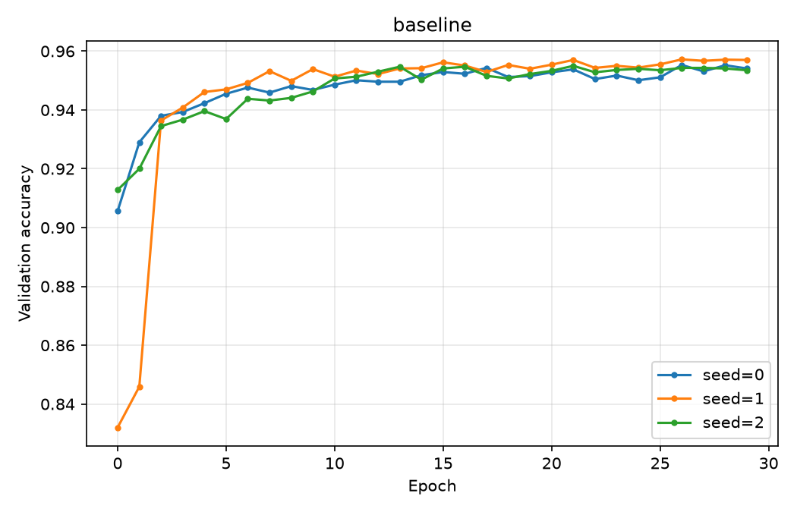

# Investigating Neural Network Generalization on MNIST

A fully connected neural network implemented from scratch in NumPy, used as a controlled testbed for studying generalization.

**Question:** For a small network trained on MNIST, which factor limits generalization first — model capacity, optimization, or the amount of available data?

## Status

| # | Sub-question | Status |
|---|--------------|--------|
| 1 | Does the implementation reproduce the reference baseline, and how much does it vary across random seeds? | ✅ Done |
| 2 | Does additional hidden-layer width improve validation accuracy, and at what cost? | 📋 Planned |
| 3 | How does the learning rate affect convergence speed and stability? | 📋 Planned |
| 4 | Does the value of a wider network depend on how much training data is available? | 📋 Planned |
| 5 | In deeper networks, how does gradient magnitude decay across layers, and does that explain the limits found above? | 📋 Planned |


## Quick Example

```python
from src.network import Network
from src.mnist_loader import load_data_wrapper

training_data, validation_data, test_data = load_data_wrapper()

net = Network([784, 30, 10], seed=0)
history = net.SGD(
    training_data,
    epochs=30,
    mini_batch_size=10,
    eta=3.0,
    evaluation_data=validation_data,
)

print(history[-1])
# {'epoch': 29, 'seconds': 49.64, 'eval_correct': 9541,
#  'eval_total': 10000, 'eval_accuracy': 0.9541}
```

Accuracy is measured on the validation set, not the test set. Elapsed time depends on hardware.

## Results

### Baseline (sub-question 1)

A `784–30–10` network trained for 30 epochs with mini-batch SGD (`mini_batch_size=10`, `eta=3.0`), repeated over three random seeds.

| Seed | Validation accuracy | Correct / total | Elapsed time |
| --- | ---: | ---: | ---: |
| 0 | 95.41% | 9,541 / 10,000 | 49.6 s |
| 1 | 95.70% | 9,570 / 10,000 | 50.0 s |
| 2 | 95.35% | 9,535 / 10,000 | 49.4 s |
| **Mean** | **95.49%** | — | — |

Standard deviation across seeds is 0.19 percentage points, with a spread of 0.35 points between the best and worst run.



Two observations. 
1. The seeds differ substantially at initialization runs would be misleading. 
2. Accuracy is essentially flat after roughly epoch 15.


## Experiments

| # | Experiment | Values swept | Script |
|---|---|---|---|
| 2 | Hidden-layer width | 16, 30, 64, 128 units | `experiments/hidden_size.py` |
| 3 | Learning rate | 0.01, 0.1, 1.0, 3.0, 10.0 | `experiments/learning_rate.py` |
| 4 | Data × capacity | {1k, 10k, 50k} × {16, 128} units | `experiments/data_efficiency.py` |

Experiments 2 and 3 vary one factor at a time against the fixed baseline. Experiment 4 sweeps two factors together to test whether they interact.

## Method

The model is a fully connected network implemented with NumPy, using sigmoid activations, a quadratic cost, backpropagation, and mini-batch stochastic gradient descent. The baseline architecture is:

```text
784 input features  →  30 hidden units  →  10 output units
```

MNIST is split into **50,000 training**, **10,000 validation**, and **10,000 test** examples. 

Each configuration is run with several seeds. The experiment scripts record per-epoch accuracy and elapsed time to `results/metrics.csv`.

## Reproducing

```bash
python3 -m venv .venv
source .venv/bin/activate
pip install -r requirements.txt

python experiments/baseline.py
python experiments/plot.py baseline   # writes results/figures/baseline.png
```

MNIST is included at `data/mnist.pkl.gz`; no download is required. Re running an experiment replaces its own rows in `results/metrics.csv`, so repeated runs do not accumulate duplicates.

## Limitations

- Only a quadratic cost with sigmoid units. Cross-entropy, ReLU, and
regularization are not implemented, so conclusions apply to this setting rather than to modern architectures.
- Three seeds per configuration gives limited statistical power; differences below roughly 0.4 percentage points are not resolvable.
- A fixed 30-epoch budget may not be equally fair to every configuration, since no early stopping is used.
- MNIST is small and close to saturated at this accuracy level, so capacity effects may be compressed relative to harder datasets.


## Attribution

The neural-network implementation is **adapted from Michael Nielsen's** [*Neural Networks and Deep Learning*](http://neuralnetworksanddeeplearning.com/chap1.html), specifically the introductory MNIST network and backpropagation code, ported to Python 3. This repository adds seed control, structured per-epoch logging, the experimental design, and the analysis.# neural-network-generalization
